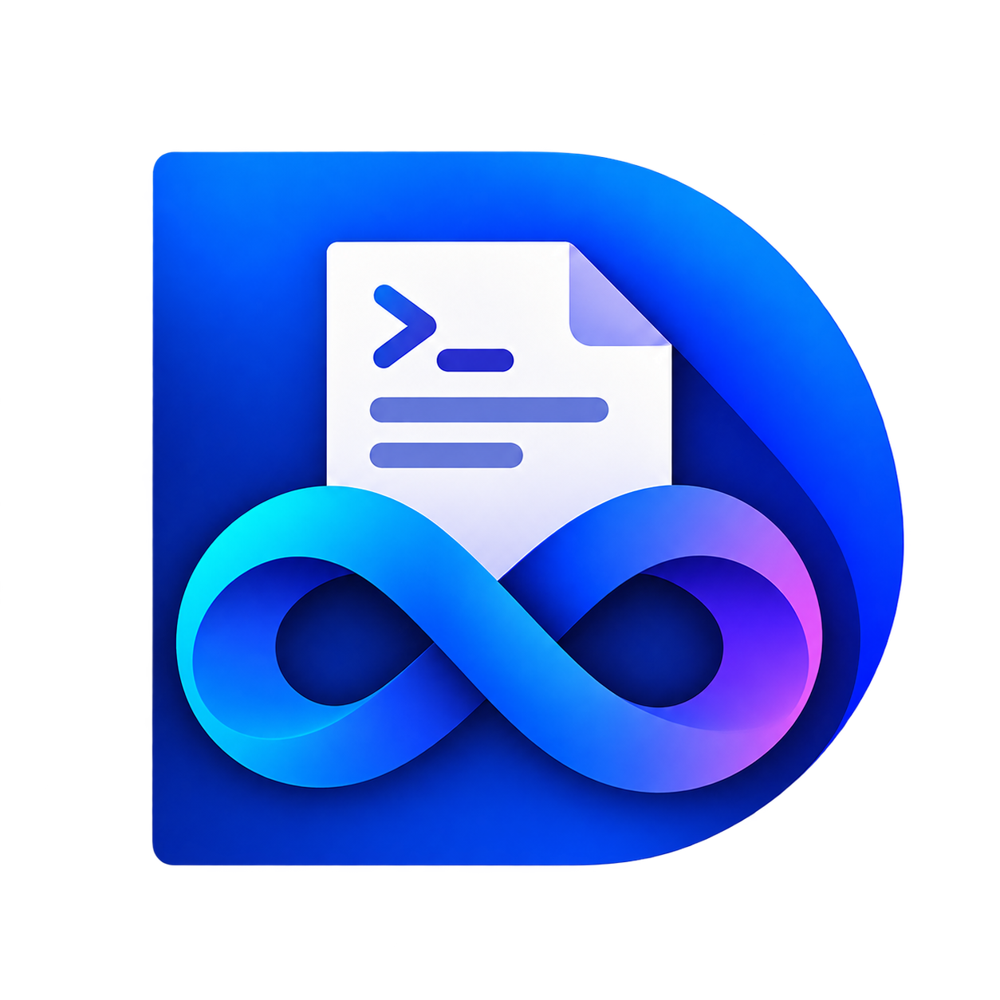

# Just the DevOps Docs

<p align="center">
  
</p>

**Just the DevOps Docs nasce per raccogliere in un unico punto fonti e approfondimenti sui diversi ambiti del mondo DevOps**, con un'attenzione particolare, al momento, a Kubernetes. L'obiettivo è rendere più semplice, trovare e consultare informazioni che altrimenti sarebbero sparse tra risorse diverse.

Le **pagine sono una rielaborazione in italiano di libri, articoli, documentazione ufficiale e blog post, con riferimenti alle fonti utilizzate**. Il progetto vuole rendere questi contenuti accessibili anche in italiano, dato che gran parte delle risorse disponibili online è in inglese.

L'intero sito web è costruito con **Docusaurus 3**.

**[Leggi la documentazione](https://devops-playground-as.github.io/just-the-devops-docs/)**

## Come nascono i contenuti

I contenuti sono studiati, rielaborati e scritti dai contributor del repository. **Imparare e comprendere più a fondo gli argomenti** sono due delle motivazioni fondamentali alla base del progetto: **il lavoro di lettura, confronto delle fonti e scrittura è parte di questo percorso e deve continuare a esserlo anche per i contributi futuri**.

Nella redazione delle pagine non è stata utilizzata AI per generare o rielaborare i contenuti. Il suo utilizzo è limitato, al più, alle correzioni sintattiche, senza intervenire sul contenuto. Anche i nuovi contributi devono rispettare questo principio: **la rielaborazione dei contenuti resta a cura dei contributor**.

## Argomenti attualmente presenti (WIP)

- **Docker**: immagini, Dockerfile, cache di build, build multi-stage, filesystem, modalità rootless e gestione del PID 1.
- **Kubernetes**: installazione, networking, service discovery, strategie di deployment, risorse e capacity planning, gestione dei segreti, CRD ed eBPF.
- **Site Reliability**: SLI e SLO.

## Avvio locale

Sono necessari Node.js **20 o superiore** e npm, come indicato in `package.json`.

```bash
npm start
```

Il server di sviluppo aggiorna le pagine quando vengono modificati i contenuti.

## Build e anteprima

```bash
npm run build
npm run serve
```

La build genera il sito statico nella cartella `build/`; il secondo comando permette di visualizzarlo in locale. La configurazione interrompe la build in presenza di link interni non validi: l'output riporta le pagine di origine e i percorsi da correggere.

## Struttura del repository

```text
docs/                  Documentazione in Markdown e MDX
blog/                  Articoli del blog
src/pages/             Pagine personalizzate, inclusa la homepage
src/components/        Componenti React
src/css/               Stili del sito
static/                Asset statici, incluse le immagini
docusaurus.config.js   Configurazione del sito e del deployment
sidebars.js            Navigazione generata dalla struttura di docs/
```

## Aggiungere o aggiornare una nota

1. Crea o modifica un file `.md` o `.mdx` nella sezione appropriata di `docs/`.
2. Usa i file `_category_.json` per configurare le categorie nella sidebar, generata automaticamente dalle cartelle.
3. Inserisci le immagini in `static/img/` e richiamale nei documenti con percorsi come `/img/k8s/nome-immagine.png`.
4. Segui le [regole di scrittura](docs/index.mdx): termini inglesi in corsivo, riferimenti a codice in blocchi di codice e fonti per ogni argomento.
5. Rielabora personalmente le fonti, rispettando i principi descritti in **Come nascono i contenuti**; limita l'eventuale uso dell'AI alle correzioni sintattiche.
6. Esegui `npm run build` per verificare che il sito venga generato e che i link interni siano validi.
