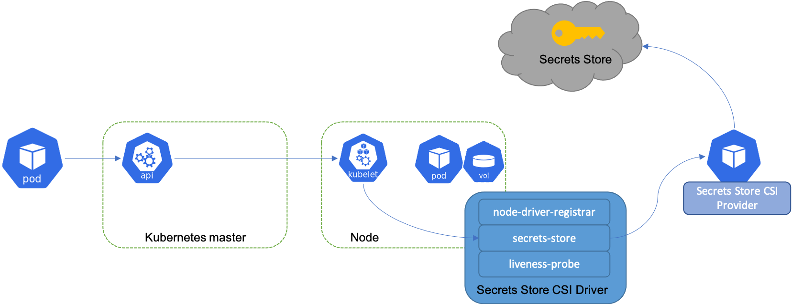
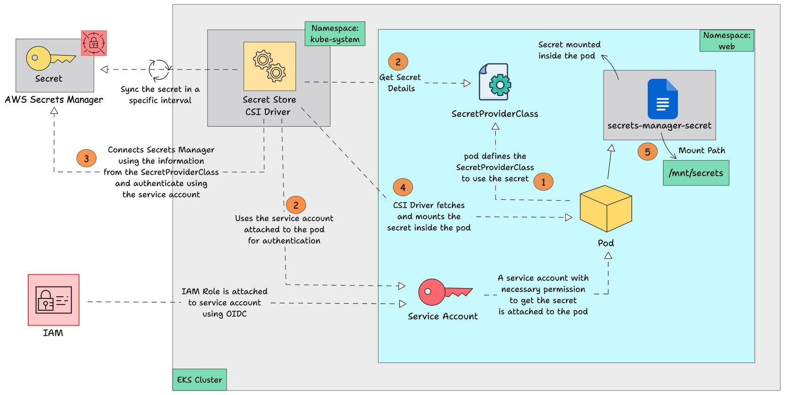
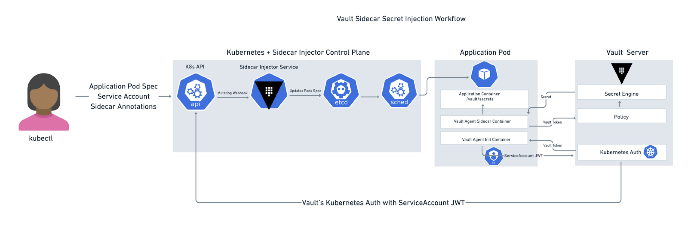

# Centralized secret management

**Vengono utilizzati dei servizi terzi** - solitamente quelli offerti dai cloud provider nel caso di soluzioni PaaS (es. AWS Secret Manager, Azure Key Vault) o soluzioni di terze parti (es. HashiCorp Vault) - **per memorizzare delle informazioni confidenziali**. Questi sistemi prendono il nome di *Secret Mangament Systems (SMS)*, ovvero servizi cloud che gestiscono i secret; offrono delle API per memorizzare i segreti con un controllo degli accessi configurabile e granulare. I sistemi SMS sono ben diversi dai *Key Management Systems (KMS)*, in quanto questi ultimi prevedono unicamente la memorizzazione di chiavi di cifratura, utilizzate per effettuare operazioni di encryption fuori dal KMS.  

> **Hashicorp Vault**. Nella pagina viene più volte menzionato [Hashicorp Vault](https://developer.hashicorp.com/vault/docs/about-vault/what-is-vault) e viene presentata una soluzione di fruizione dei segreti compatibile con questo prodotto. Vault è un prodotto fornito da Hashicorp - società già famosa per soluzioni come Terraform e Consul - che si occupa della gestione dei segreti. Vault offre numerosi plugin che consentono di ampliare le sue funzionalità e di integrarsi con servizi di terze parti.

## Secrets Store CSI driver

La *Container Store Interface (CSI)* è una API di Kubenertes per esporre sistemi di storage alle applicazioni containerizzate. In altri termini, la CSI consente di montare come volume in Kubernetes storage providers di terze parti. Di particolare interesse per la gestione dei segreti il *Secret Store CSI driver* che permette di integrare direttamente sistemi SMSs, nonchè i segreti al loro interno, come volume CSI. Il *Secret Store CSI driver* supporta i sistemi SMS dei maggiori cloud providers ed è un *DaemonSet* per facilitare la comunicazione con ogni istanza di Kubelet.



**Il *Secrets Store CSI Driver* utilizza due *Custom Resource Definitions (CRDs)*** che venogno utilizzate per effettuare la configurazione del provider e per fornire dei parametri al CSI driver, rispettivamente `SecretProviderClass` e `SecretProviderClassPodStatus`. La prima deve essere configurata appositamente per associare il provider, indicando parametri specifici del provider; la seconda, viene creata dal CSI driver e rappresenta il binding tra il pod e la `SecretProviderClass`. Dopo che il setup viene fatto, l'utilizzo dei *secret volume* è immediato.



Di seguito viene mostrato un esempio di `SecretProviderClass` nel caso di Vault e di comeil volume viene referenziato da un Pod.


```yaml
apiVersion: secrets-store.csi.x-k8s.io/v1
kind: SecretProviderClass
metadata:
  name: vault-database
spec:
  provider: vault                                
  parameters:
    vaultAddress: "http://vault.default:8200"    
    roleName: "database"                         
    objects: |
      - objectName: "database-password"          
        secretPath: "secret/data/database-creds" 
        secretKey: "password"                 
```

```yaml
kind: Pod
apiVersion: v1
metadata:
  name: shell-pod
spec:
  serviceAccountName: vault-access-sa  
  containers:
    - image: k8spatterns/random
      volumeMounts:
      - name: secrets-store
        mountPath: "/secrets-store"      
  volumes:
    - name: secrets-store
      csi:                             
        driver: secrets-store.csi.k8s.io
        readOnly: true
        volumeAttributes:
          secretProviderClass: "vault-database"           
```
Il Pod deve fare esplicito riferimento al Secret che contiene le credenziali necessarie per accedere all'istanza di Vault che contiene i segreti.

L'implicazione di sicurezza da considerare quando si utilizza il *Secrets Store CSI driver* è la possibilità di leggere i segreti all'interno del Pod, da parte di chi ha accesso al namespace e può utilizzare il comando `exec`. Tuttavia, questo comportamento rispecchia quello atteso, dato che chi ha accesso al namespace ci si aspetta possa fare un certo numero di azioni, compresa l'esecuzione del comando `exec`. Nel caso si voglia impiegare una postura di sicurezza più stringente si può ricorrere a immagini distroless o si può disabilitare `exec`.

## Pod Injection 

Un'applicazione può utilizzare direttamente un sistema SMS, sfruttando la corrispettiva librerie client. Lo svantaggio principale di questo approccio è la gestione delle credenziali legate al meccanismo di autenticazione previsto dalla libreria. In aggiunta, il recupero dei segreti direttamente nell'applicazione crea una dipendenza verso un particolare sistema SMS: passare da Vault a AWS Secret Manager potrebbe richiedere una modifica sostanziale del codice. 

L'utilizzo del *Secrets Store CSI driver* riduce l'accoppiamento tra sistema di gestione dei segreti e applicazione, ma sono comunque disponibili soluzioni alternative per la gestione dei segreti che utilizzano principalmente due pattern specifici: *Init Container* e *Sidecar Container*.

- **Init Container**. L'Init Container si occupa di recuperare i segreti da un SMS per poi copiarli in un volume locale condiviso, montato anche nell'application container. I segreti sono recuperati solo all'avvio del Pod, sfruttando l'Init Container.

- **Sidecar Container**. Come nel caso dell'Init Container, questa volta è il Sidecar ad occuparsi del recupero dei segreti e della loro memorizzazione nel volume condivisio, con il vantaggio che è possibile aggiornare i segreti in caso di rotazione visto che il Sidecar container ha un ciclo di vita legato all'application container.

### Vault Agent Injector

Il **Vault Agent Injector altera la specifica dei Pod inserendo un sidecar container che recupera e renderizza i segreti Vault in un volume condiviso**. In questo modo l'application container può consumare i segreti direttamente dal volume senza essere consapevole di Vault. 



La modifica della specifica del Pod è possibile in quanto l'Injector è un Kubernetes Mutation Webhook Controller, intercetta gli eventi legati ai Pod e applica delle modifiche a tali Pod, se una particolare annotazione è presente. In particolare, Vault Agent Injector intercetta gli eventi di `CREATE` e `UPDATE` di un Pod e controlla se è presente l'annotazione `vault.hashicorp.com/agent-inject: true`.

Vault Agent Injector può scegliere di iniettare un container seguendo l'init o il sidecar container pattern. Nel primo caso, l'init container popolerà il volume condiviso con i segreti richiesti su Vault, prima che l'application container venga avviato; nel secondo caso, il sidecar continuerà ad esistere ed autenticarsi a Vault, fornendo comunque i segreti all'application container utilizzando il volume condiviso.

Infine, per autenticarsi su Vault l'Injector ha bisogno di un ServiceAccount che venga richiamato esplicitamente dal Pod. Questo ServiceAccount deve avere associato un ruolo Vault e una policy che gli consenta di leggere determinati segreti.


**Riferimenti**.

- [Kubernetes Patterns - Reusable Elements for Designing Cloud Native Applications, Bilgin Ibryam and Roland Huß](https://www.oreilly.com/library/view/kubernetes-patterns/9781492050278/)
- [Secret Store CSI Driver](https://secrets-store-csi-driver.sigs.k8s.io/introduction)
- [Manage Secrets on AWS EKS using Secrets Store CSI Dirver](https://devopscube.com/secrets-store-csi-dirver-eks/)
- [Vault Agent Injector vs. Vault CSI Provider](https://developer.hashicorp.com/vault/docs/deploy/kubernetes/injector-csi#vault-sidecar-agent-injector)
- [Vault Agent Injector](https://developer.hashicorp.com/vault/docs/deploy/kubernetes/injector)