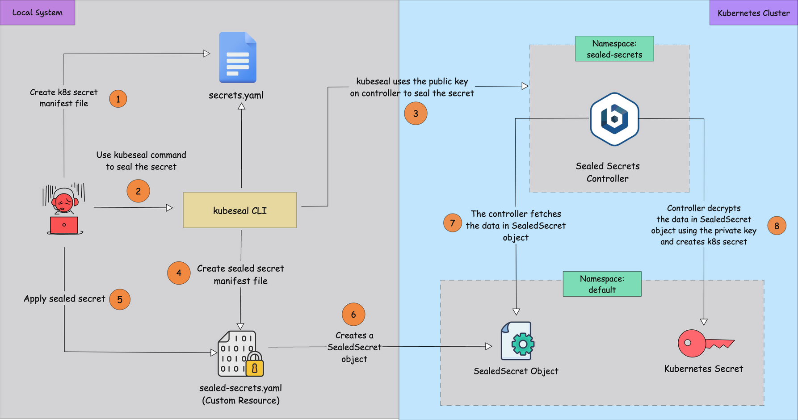
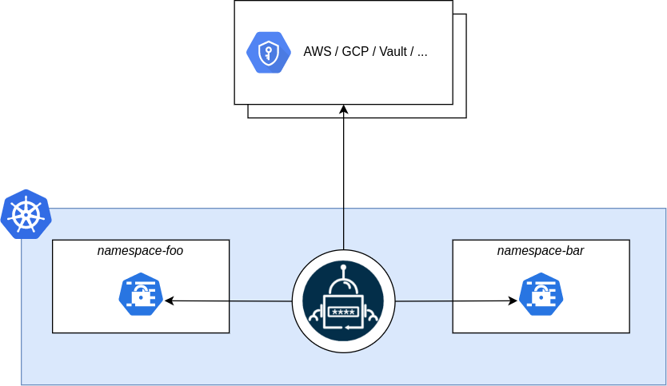
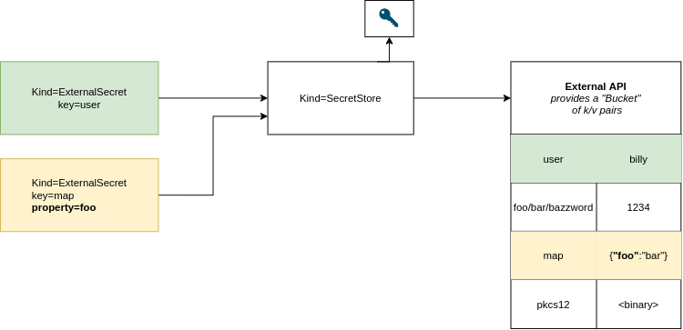

# Out-of-cluster encryption 

Le informazioni vengono memorizzate cifrate fuori dal cluster Kubernetes e la loro trasformazione avviene appena prima di entrare nel cluster o all'interno del cluster grazie ad un operatore sempre in esecuzione. Ci sono diversi progetti che consentono di implementare questa tecnica e in questa pagina ne sono descritti alcuni.

## Sealed Secrets

La soluzione di Sealed Secret nasce dal seguente problema 

> *"I can manage all my K8s config in git, except Secrets"*. 

La soluzione consente di memorizzare cifrate le informazioni di un Secret Kubernetes all'interno di una *Custom Resource Definition (CRD)* denominata *SealedSecret*. **La creazione del Secret Kubernetes avverrà ad opera di un operatore dedicato che per ogni SealedSecret creerà un Secret in chiaro**. In particolare, Sealed Secrets è composto da due parti, una cluster-side, l'operatore, e una client-side, la la CLI *kubeseal*.



La decifratura avviene nel cluster, mentre la cifratura avviene fuori dal cluster (*out of cluster*) utilizzando la CLI *kubeseal*, creando SealedSecret da memorizzare in sicurezza anche in un repository Git. Questo espone anche uno dei possibili svantaggi della soluzione, in quanto la decifratura richiede un Operator in esecuzione sul cluster: se la chiave privata non viene conservata e l'operatore viene disinstallato non è possibile recuperare il contenuto dei segreti. 

La cifratura avviene dei segreti avviene con una chiave simmetrica, generata casualmente da *kubeseal* ed utilizzata come chiave di sessione, a sua volta cifrata asimmetricamente. La chiave privata viene memorizzata nel cluster ed è automaticamente creata dal SealedSecret Operator ed è compito del cluster administrator effettuare il backup e la rotazione di questa chiave se necessario. La chiave pubblica viene utilizzata da *kubeseal* e può essere recuperata dal cluster o da un file memorizzato anch'esso su Git. 

Sealed Secrets offre ambiti di utilizzo:

- *strict*, consente di creare SealedSecret nello stesso namespace e con lo stesso nome del Secret originale;
- *namespace-wide*, consente di applicare i SealedSecret con un nome diverso, ma nello stesso namespace del Secret originale;
- *cluster-wide*, il nome ed il namespace possono essere cambiati.

## External Secrets

**L'External Secrets Operator (ESO) è un operatore Kubernetes che consente di inserire le informazioni presenti in un determinato *Secret Management System (SMS)* all'interno dei Kubernetes Secret**. L'operatore supporta la maggior parte dei moderni sistemi SMS, come AWS Secrets Manager, Hashicorp Vault e Google Secrets Manager, e consente quindi di sincronizzare i segreti provenienti da API esterne in Kubernetes.



Per capire il meccanismo di funzionamento dell'operatore, bisogna considerare il suo data model che si basa principalmente su due *Custom Resource Definition (CRD)*.



Il `SecretStore` è la risorsa che detiene il tipo e la configurazione per accedere al sistema SMS esterno (nel caso AWS Secret Manager il riferimento ad access key id e secret access key); l'`ExternalSecret` - che referenzia un `SecretStore` - dove è contenuta l'informazione su quali dati recuperare. Il controller utilizzerà l'`ExternalSecret` come blueprint per creare un Kubernetes Secret con al suo interno i dati contenuti nel sistema SMS.

```yaml
apiVersion: external-secrets.io/v1
kind: SecretStore
metadata:
  name: secretstore-sample
spec:
  provider:
    aws:
      service: SecretsManager
      region: us-east-1
      auth:
        secretRef:
          accessKeyIDSecretRef:
            name: awssm-secret
            key: access-key
          secretAccessKeySecretRef:
            name: awssm-secret
            key: secret-access-key
```
```yaml
apiVersion: external-secrets.io/v1
kind: ExternalSecret
metadata:
  name: example
spec:
  refreshInterval: 1h0m0s
  secretStoreRef:
    name: secretstore-sample
    kind: SecretStore
  target:
    name: secret-to-be-created
    creationPolicy: Owner
  data:
  - secretKey: secret-key-to-be-managed
    remoteRef:
      key: provider-key
      version: provider-key-version
      property: provider-key-property
  dataFrom:
  - extract:
      key: remote-key-in-the-provider
```
L'utilizzo di ESO è pensato per due *persona*: un Cluster Operator, che si occupa di installare l'operatore e definire le policy di accesso, e un Application Developer, responsabile della creazione degli `ExternalSecrets` e della configurazione applicativa.

ESO offre anche una terza CRD denominata `ClusterSecretStore`, ovvero un `SecretStore` che copre tutto il cluster e che può essere referenziato da più namespace. Tale risorsa fornisce un unico riferimento per accedere al sistema SMS.

## Sops

In alcuni casi è possibile utilizzare soluzioni puramente client-side, come *sops*, sigla che sta per *Secret OperationS*. Sops non è specificatamente pensato per Kubernetes ma consente di cifrare file YAML o JSON, per memorizzarli in repository Git, il che è utile se si utilizza un approccio GitOps per il deploy. La cifratura dei file avviene solo per i valori, mentre le chiavi rimangono in chiaro.

La cifratura con sops può avvenire ricorrendo ad *age*, uno strumento di crittografia asimmetrica utilizzato per generare le chiavi localmente, oppure sfruttando una chiave presente su di un *Key Management System (KMS)* come AWS KMS, Google KMS o Azure Key Vault. In altri termini, nel caso di age vengono prima generate le chiavi e poi utilizzate da sops per cifrare/decifrare; nel caso di utilizzo di un KMS, sarà sops ad integrarsi e recuperare la chiave utilizzata per la cifratura.

Nel caso di age

```shell
$ sops encrypt --age age1yt3tfqlfrwdwx0z0ynwplcr6qxcxfaqycuprpmy89nr83ltx74tqdpszlw test.yaml > test.enc.yaml
```

Per un sistema KMS, come nel caso di AWS KMS è sufficiente impostare le credenziali AWS secondo la [*credential provider chain*](https://docs.aws.amazon.com/sdkref/latest/guide/standardized-credentials.html), dato che sops utilizza l'SDK di AWS per Go. Pertanto, è sufficiente il comando `sops edit <file>`, che gestirà il processo di cifratura, decifratura in maniera completamente trasparente. Un esempio di file cifrato è mostrato di seguito.

```yaml
myapp1: ENC[AES256_GCM,data:Tr7o=,iv:1=,aad:No=,tag:k=]
app2:
    db:
        user: ENC[AES256_GCM,data:CwE4O1s=,iv:2k=,aad:o=,tag:w==]
        password: ENC[AES256_GCM,data:p673w==,iv:YY=,aad:UQ=,tag:A=]
    # private key for secret operations in app2
    key: |-
        ENC[AES256_GCM,data:Ea3kL5O5U8=,iv:DM=,aad:FKA=,tag:EA==]
an_array:
    - ENC[AES256_GCM,data:v8jQ=,iv:HBE=,aad:21c=,tag:gA==]
    - ENC[AES256_GCM,data:X10=,iv:o8=,aad:CQ=,tag:Hw==]
    - ENC[AES256_GCM,data:KN=,iv:160=,aad:fI4=,tag:tNw==]
```
Sops può quindi essere utilizzato per cifrare i Secret Kubernetes da applicare nel cluster, per memorizzarli in sicurrezza in repository Git, risultando così ideale per soluzioni GitOps. Tuttavia, non appena i file verranno applicati all'interno del cluster, chiunque abbia accessi elevati potrà legggere i dati direttamente via Kubernetes API.

**Riferimenti**

- [Sealed Secrets](https://github.com/bitnami/sealed-secrets)
- [How to Encrypt Kubernetes Secrets using Sealed Secrets (Detailed Guide)](https://devopscube.com/sealed-secrets-kubernetes/#how-sealed-secrets-work)
- [External Secrets Operator](https://external-secrets.io/latest/)
- [sops](https://getsops.io/)
- [Kubernetes Patterns - Reusable Elements for Designing Cloud Native Applications, Bilgin Ibryam and Roland Huß](https://www.oreilly.com/library/view/kubernetes-patterns/9781492050278/)